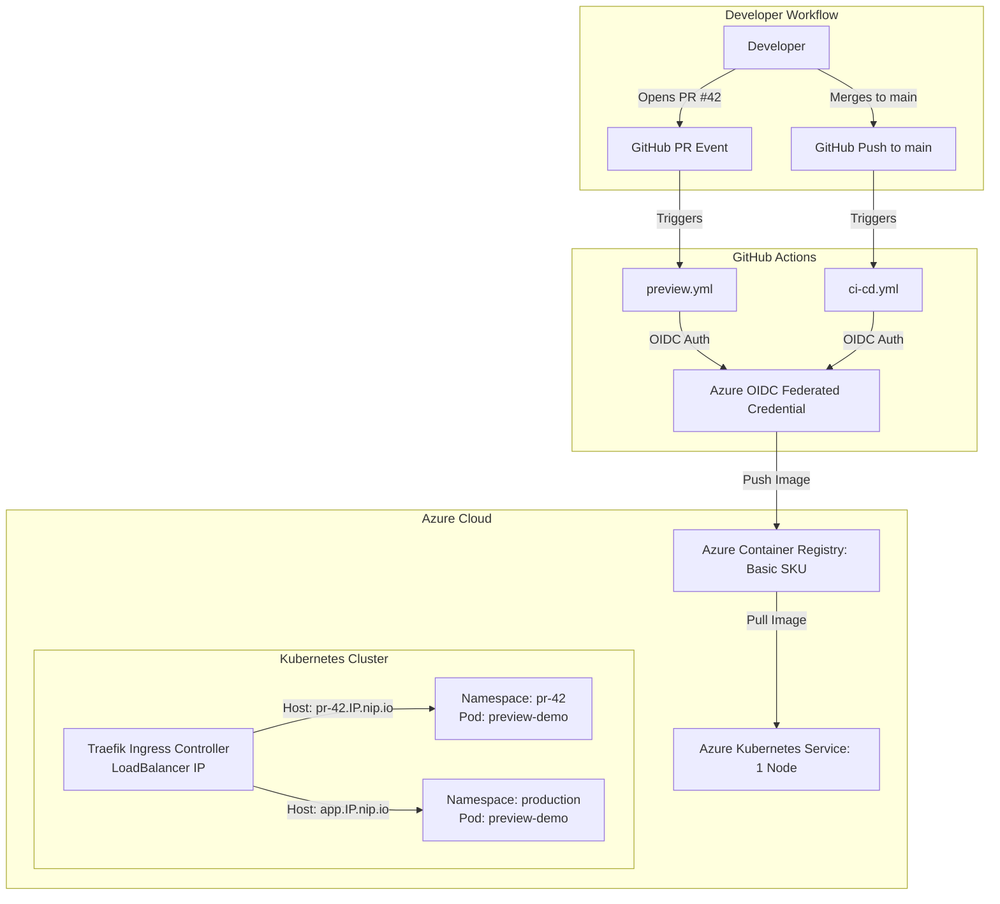

# Preview Environment Manager: Architecture & Design Document

## 1. Executive Summary & Goals
The **Preview Environment Manager** provides automated, isolated preview environments for Kubernetes-based microservices using **Azure Kubernetes Service (AKS)**, **Azure Container Registry (ACR)**, **Traefik**, and **GitHub Actions**.

The platform is designed in two primary layers:
- **Layer 0 (Base Production Pipeline)**: Every commit merged to `main` automatically builds, tests, containerizes, pushes to ACR, and deploys to the `production` Kubernetes namespace.
- **Layer 1 (Preview Environment Automation)**: Every Pull Request (PR) automatically provisions an isolated Kubernetes namespace `pr-<number>` with an ingress route at `http://pr-<number>.<INGRESS_IP>.nip.io`. When the PR is closed or merged, the preview namespace is automatically torn down.

---

## 2. High-Level Architecture

---

## 3. Step-by-Step Design Choices & Rationales

### Step 1: Runtime & Build Tooling
- **Choice**: **Java 21 LTS** with **Spring Boot 4.1.2** (latest verified stable release) and **Maven Wrapper (`mvnw`)**.
- **Rationale**:
  - Java 21 provides Long-Term Support, modern language features (records, pattern matching), and native Virtual Thread capabilities.
  - Maven Wrapper guarantees consistent builds across developer workstations (Windows/macOS/Linux) and GitHub Actions Ubuntu runners without requiring a pre-installed Maven binary.
  - Spring Boot Actuator provides built-in, standards-compliant Kubernetes liveness and readiness probe endpoints out-of-the-box (`/actuator/health/liveness` and `/actuator/health/readiness`).
  - No bloated dependencies: No database, security framework, or template engines are bundled, keeping container startup under a few seconds and images lightweight.

### Step 2: Configuration & Environment Injection
- **Choice**: Externalized environment properties via standard Spring expressions with sensible local fallbacks:
  - `server.port=8080`
  - `app.message=Hello from Layer 0`
  - `app.git-sha=${GIT_SHA:dev}`
  - `app.environment=${APP_ENV:local}`
- **Rationale**:
  - The application binary remains immutable across environments (Twelve-Factor App methodology).
  - During local development or testing, environment variables are optional because defaults (`dev`, `local`) take over.
  - In Kubernetes, `GIT_SHA` and `APP_ENV` are injected via Deployment environment variables and ConfigMaps/Downward API (`HOSTNAME`).

### Step 3: Endpoints & Observability
- **Choice**:
  - `GET /`: Returns clean HTML rendering application metadata (Message, Git SHA, Environment, Pod Hostname).
  - `GET /api/info`: Returns JSON payload for programmatic verification and smoke-testing.
  - `GET /actuator/health`: Exposes health status, with probe endpoints enabled for Kubernetes liveness/readiness checks.
- **Rationale**:
  - Demonstrates immediately to evaluators and reviewers which commit SHA and namespace are currently serving traffic.
  - In Kubernetes, the pod's hostname equals the pod's name, confirming that traffic reaches distinct pods in isolated namespaces.

### Step 4: Containerization & Registry (ACR)
- **Choice**: Multi-stage Docker build with pinned **Eclipse Temurin 21.0.13_9** base images and Azure Container Registry (ACR) on the **Basic SKU**.
  - **Stage 1 (Builder)**: `eclipse-temurin:21.0.13_9-jdk-jammy`. Uses the Maven wrapper, pre-fetches dependencies with `dependency:resolve` in a dedicated layer for Docker build caching, and compiles the JAR with `-DskipTests`.
  - **Stage 2 (Runtime)**: `eclipse-temurin:21.0.13_9-jre-jammy`. Stripped-down JRE image containing no compiler or build tools.
  - **Security (Non-root user)**: A dedicated `appuser:appgroup` (UID/GID 1001) is created and activated (`USER appuser`) to prevent privilege escalation and container breakout attacks in Kubernetes.
  - **Memory Limits**: `JAVA_TOOL_OPTIONS="-XX:MaxRAMPercentage=75.0 -XX:+UseG1GC"` ensures the JVM dynamically respects container cgroup memory limits, preventing out-of-memory (OOM) kills.
  - **Build Arguments**: `ARG GIT_SHA=dev` is injected during build time and stored as an environment variable `ENV GIT_SHA` so the running container knows its commit provenance.
  - **Image Tagging**: Docker images are tagged using the **full Git commit SHA** (`${{ github.sha }}`) rather than mutable tags like `latest`. This guarantees reproducibility and zero ambiguity.

### Step 5: Kubernetes Ingress Controller (Traefik)
- **Choice**: **Traefik** deployed via official Helm chart.
- **Rationale**:
  - The legacy `ingress-nginx` controller was formally retired in March 2026. Traefik is actively maintained, cloud-native, and handles dynamic routing seamlessly.
  - Traefik obtains an Azure public IP via a `LoadBalancer` service, serving as the single entry point to the AKS cluster.

### Step 6: Dynamic DNS with nip.io
- **Choice**: Hostname routing via `nip.io` wildcard DNS (e.g. `pr-42.<INGRESS_IP>.nip.io`).
- **Rationale**:
  - `nip.io` resolves any IP embedded in the hostname directly to that IP without requiring custom domain registration, DNS provider API keys, or manual DNS records.
  - Perfectly matches dynamic PR lifecycles: any PR number maps immediately to the ingress IP without propagation delay.

### Step 7: Kubernetes Manifest Strategy
- **Choice**: Plain Kubernetes YAML files stored in `k8s/` parameterized with `envsubst`.
- **Rationale**:
  - Eliminates unnecessary abstractions and complexities like Helm or Kustomize for our application service while keeping manifests readable and standard.
  - Parameters like `$NAMESPACE`, `$IMAGE_TAG`, and `$HOST_NAME` are injected deterministically during pipeline execution.

### Step 8: Security & Authentication (OIDC Federated Credentials)
- **Choice**: OpenID Connect (OIDC) federation between GitHub Actions and Azure (`azure/login@v2`).
- **Rationale**:
  - Zero stored secrets: No service principal passwords, long-lived client secrets, or sensitive kubeconfig files are kept in GitHub repository secrets or source control.
  - GitHub Actions mints short-lived cryptographically signed JWT tokens that Azure validates against the configured federated identity credential.

